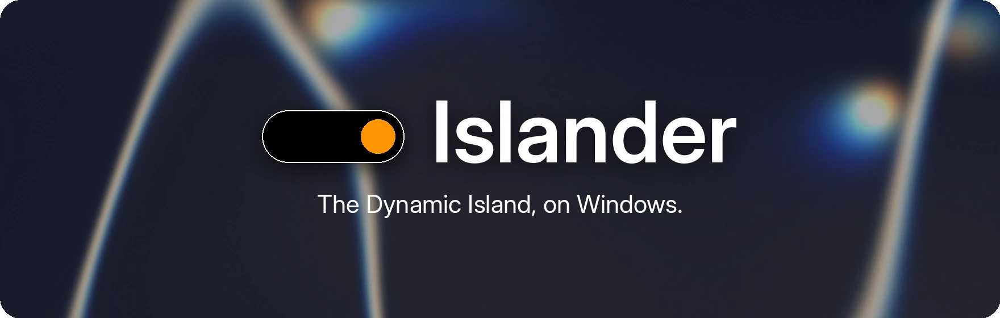
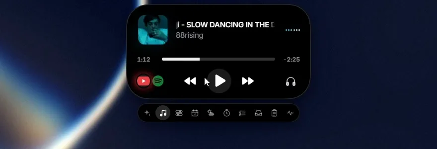

<p align="center">
  
</p>

<p align="center">
  <b>The most faithful 1:1 Dynamic Island for Windows 10 and 11.</b><br>
  Every spring, morph and cover flip from the iPhone, rebuilt for the desktop.
</p>

<p align="center">
  <a href="https://github.com/aayus7/Islander/releases/latest"></a>
  <a href="https://aayus7.github.io/Islander/"></a>
  
  <a href="LICENSE"></a>
  <a href="https://ko-fi.com/aayus7"></a>
</p>

<p align="center">
  
</p>

Islander puts a living Dynamic Island at the top of your screen. It isn't a look-alike: the shape is
the same continuous-curvature squircle, the motion uses the same spring physics as iOS, and every
transition (expanding, splitting, the album cover turning on a skip) is rebuilt frame by frame to
match the iPhone. It runs quietly as a transparent overlay, never steals focus, and gets out of the
way for fullscreen games and video.

<p align="center"><a href="https://github.com/aayus7/Islander/releases/latest"><b>Download Islander</b></a> · free and open source · <a href="https://ko-fi.com/aayus7">support it on Ko-fi</a></p>

---

## Now Playing

Media from every app (Spotify, YouTube in your browser, mpv, Stremio and more) with real album art,
a waveform that follows the actual audio, a draggable scrubber and one-tap source switching.

<p align="center"></p>

Skip a track and the cover turns around its axis, blurs and lands sharp, just like iOS. Tucked away
as a pill, it keeps the art in view with a soft glow in the album's own colour, and it turns there too.

<p align="center"></p>

Download something, record the screen or start a timer while music plays, and the second activity
buds off into its own bubble, then melts back in when it's done. A second player does the same.

<p align="center"></p>

## Ask anything

Press `Ctrl+Alt+Space` and the island becomes a Siri-style search bar. Type or speak a question and
it thinks in a glowing circle, then answers in a sentence or two with its source, using live web,
news and sports results. Free out of the box, no API key needed.

<p align="center"></p>

## Share with your phone, AirDrop-style

Phones and computers running [LocalSend](https://localsend.org) appear right in the island. Accept
photos from your phone with one click, watch them arrive, and send files back from the Shelf.

<p align="center"></p>

## Notifications that feel native

Windows notifications become island banners. Messaging apps like Discord and WhatsApp show the
sender's profile picture and any image they sent, and a new message replaces the one on screen
right away. Swipe one away, or click it to open the app.

<p align="center"></p>

## Every download, at a glance

Progress, speed and time left for browser downloads, **Internet Download Manager** and **Mister
Download Manager**. Hover for the full list, cancel one, or click a finished file to open its folder.

<p align="center"></p>

## Connected, in 3D

Connect AirPods or Beats and the island plays a 360° animation of your exact model with its battery.

<p align="center"></p>

## Volume, brightness and the rest

Windows' pop-ups, replaced: volume and brightness bars, a Ring / Silent pill for mute, and Caps Lock.
With the music player open, the volume keys add a volume row under it instead.

<p align="center"></p>

## Know when you're on

A green dot while an app uses your camera and an orange one for the microphone, exactly where iOS
puts them. Open the island and the dot glides out beside it.

<p align="center"></p>

## Weather that moves

Live skies, an hourly strip, a 7-day forecast and the full set of details, in the style of iOS Weather.

<p align="center"></p>

## Live Activities

Start a timer, stopwatch or focus session and it stays with you as a live pill while you work.

<p align="center"></p>

## Everything, one hover away

Scroll to move between tabs: Search or Ask (with voice), Control Center, calendar, weather, timers,
notes and to-dos, a file shelf, clipboard history and system stats. Turn off or reorder any of them.

<p align="center"></p>

---

## Install

Download `Islander_<version>_x64-setup.exe` from [Releases](https://github.com/aayus7/Islander/releases/latest)
and run it. Islander updates itself from then on. Right-click the island for Settings.

## All features

<details>
<summary><b>The full list</b></summary>

### The island
- **iOS motion**: Apple-style springs (SwiftUI `response` / `dampingFraction`) that keep their velocity when
  interrupted. Default, Bouncy, Smooth and Snappy presets plus a speed slider.
- **Shape**: squircle (continuous-curvature) outline that becomes a true capsule when collapsed. Content
  sits in a fixed frame, so text never jitters while the shape morphs.
- **Put it anywhere**: drag the island to the top, bottom, left or right edge of the screen; drop zones
  show where it will land. On the sides it becomes a slim vertical pill (with a horizontal waveform),
  with the same cover glow and turn, and a second activity's bubble underneath.
  Also from the island's menu (Move Island…) or Settings → Position.
- **Hairline rim**: a thin outline that tints with what the island is doing: red when muted, orange for
  timers, yellow for the stopwatch, green for downloads and Focus breaks.
- **Idle styles**: a waterdrop notch attached to the screen edge, a dot, or the classic pill.
- **Split bubble**: a second live activity grows out from behind the island into its own bubble with a
  gooey bridge, and melts back in. In a right-hand corner it buds off to the left, toward the screen.
- **Smart overlay window**: transparent, always on top, never steals focus, not in Alt+Tab or the
  taskbar. Click-through everywhere except the island.
- **Smooth from the first hover**: right after launch every panel is prepared once, invisibly, so the
  very first open is as smooth as the hundredth.
- **Gestures**: hover to expand (or click), scroll to switch tabs, drag to move. Pointing at a
  notification keeps it up so you can click it, instead of opening the island.
- **Gets out of the way**: hides while a fullscreen game, F11 browser or fullscreen video is in front,
  with optional auto-hide until you touch the screen edge.
- **Multi-monitor & DPI**: primary display, a specific display, or follow the mouse.

### Tabs (scroll to switch; each can be turned off and reordered)
| Tab | What it does |
|---|---|
| **Search or Ask** | Siri-style AI bar. Works out of the box with **no API key** through Islander's free service, with live web, news and sports-score lookups. **Ask by voice**: tap the mic, speak, and it asks when you pause. Short answers, sources, follow-ups and a remembered conversation; shrinks to a glowing circle while thinking. After an answer, just type to ask again, or press Backspace for a fresh question. Maths and unit conversions (`12 km to mi`) are answered instantly on your PC. Optional real **liquid glass**. |
| **Now Playing** | Media from every app (Spotify, browsers, mpv, Stremio…) with artwork (movie and series posters for mpv/Stremio), a 5-bar waveform driven by the real audio (iOS-style, quiet when the music is quiet), 3D cover flip, a draggable scrubber, rolling-digit timestamps, a **LIVE** bar for streams, source switching, an output-device picker and click-to-open the app. |
| **Downloads** | Appears while something downloads: browser downloads (via the extension), **Mister Download Manager** and **Internet Download Manager**. Hover for every download with progress and speed, cancel one, or click a finished one to open its folder. |
| **Today** | Month calendar, a weather glance (Open-Meteo, no key; located by Windows' location service, or set your city) with a sun or moon that playfully follows your cursor, and your next reminders. |
| **Timer & Focus** | iOS Clock-style timer, stopwatch (with laps) and Focus (Pomodoro). Keeps running as a live pill while collapsed and chimes when done. |
| **Notes & To-Do** | A quick scratchpad and a Reminders-style checklist, saved automatically. |
| **Shelf** | Drop files, folders or images on the island, then drag them out into any app. Open, show in Explorer, remove, and convert images to JPG/PNG/WebP. **Nearby sharing**: phones and computers running [LocalSend](https://localsend.org) show up under the Shelf; tap one to send your files, or receive from them (you're asked first; files land in Downloads and on the Shelf). |
| **Clipboard** | History of copied text, links, images and files. Click to copy again, drag out, pin, delete. Content password managers mark as private is never recorded. |
| **System** | Activity-style rings for CPU, GPU, memory and disk, plus live upload/download speed. |
| **Controls** | Control Center: Wi-Fi and Bluetooth (with pages to join networks and connect headphones), brightness and volume sliders, Airplane mode, Do Not Disturb, Light/Dark, Screenshot, Lock, Sleep, and pinned apps, folders and URLs. |

### Live activities & system
- **Notifications**: Windows notifications appear as island banners with the app icon; for messaging
  apps (Discord, WhatsApp…) the sender's picture with the app as a badge, like iOS. Swipe to dismiss,
  click to open. Do Not Disturb silences them. Timer and Focus alerts show even over an open panel.
- **Replaces Windows' popups** (optional): the volume/media keys and notification banners are handled by
  the island, and Windows' own volume popup stays hidden. Your settings are restored when you quit.
- **Volume & mute pills**, plus Caps Lock and Num Lock pills.
- **Privacy dots**: green while an app uses the camera, orange for the microphone.
- **AirPods & Beats**: connecting plays a 360° animation of your model (AirPods 1–4, Pro 1–3, Max,
  Beats Fit Pro) with its battery level. Other headphones get a drawn icon. Try any model from
  Settings → Notifications & System → Bluetooth devices → Preview connection.
- **Low battery** banners for Bluetooth devices.

### Settings
macOS-style settings window (right-click the island → Settings) with search: behaviour, tabs, theme,
transparency, size, font, animation style and speed, position, weather, AI, hotkeys, system pills,
notifications, software updates and more. Every change applies live.

### Automatic updates
Installed copies check for new versions, download them in the background and offer to restart. Updates
are signed, so only builds made with your signing key are accepted.

</details>

---

## Getting started

**One click:** run `run-island.bat`. It installs Node, Rust and the Visual Studio Build Tools if they're
missing, then starts the island in development mode (output also goes to `dev-output.log`).

**Manually:**
```powershell
npm install
npm run tauri dev      # run with hot reload
```

> Run it **without** administrator rights: Windows blocks drag-and-drop from Explorer into admin apps,
> so the Shelf couldn't receive files.

### Building a release
Run `build-release.bat`. It builds an optimized, signed installer into the `release` folder:
`Islander_<version>_x64-setup.exe`, its `.sig` signature and `latest.json` (the update feed, with the
text from `release-notes.txt`).

To publish, create a GitHub release on `aayus7/Islander` tagged `v<version>` and upload all three files.
Installed copies look for `latest.json` in the **latest** release, so the repository must be public for
updates and downloads to work.

The signing key lives in `.keys/` (ignored by Git). **Never share or commit it**: anyone with it could
push updates to your users, and if you lose it, existing installs can't be updated any more.

### Browser extension (optional)
For perfectly synced browser media, live-stream detection, jump-to-tab and browser download progress,
load the extension in `extension/`:
- **Firefox**: `about:debugging` → This Firefox → Load Temporary Add-on → `extension/manifest.json`.
- **Chrome / Edge**: `chrome://extensions` → Developer mode → Load unpacked → the `extension` folder.

It only talks to the island on `127.0.0.1`; nothing leaves your PC. Release builds work without it.

### AI ("Search or Ask")
Nothing to set up for users: questions go to Islander's free service (the Cloudflare Worker in
`relay/`, see `relay/README.md`), with a fair daily limit per PC. Optionally, paste your own Gemini key
in Settings → Search or Ask (from https://aistudio.google.com/apikey) to use your own quota.

**Voice**: the mic button records only while you speak and nothing is kept. Speech is turned into text
by Whisper on Islander's free service (or, where Windows' "Online speech recognition" is on, typed out
live by Windows itself), then asked like a typed question.

### Hotkeys
| Action | Default |
|---|---|
| Search or Ask | `Ctrl+Alt+Space` (change it in Settings if another app uses it) |
| Hide / show the island | `Ctrl+Alt+D` |

---

## Design in the browser
`npm run dev` and open http://localhost:1420: a fake desktop with mock media and a panel to try states,
animation styles and speed, no Windows needed.

## Project layout
```
src/
  island/Island.tsx        shape, springs, modes, tabs, live activities, docking, warm-up
  island/SidePill.tsx      vertical forms for the left/right edges
  island/content.tsx       Now Playing (compact & expanded), output picker
  island/AiPanel.tsx       Search or Ask (typing, voice, answers)
  island/Glass.tsx         WebGL liquid glass
  island/modules/          Today, Clock, Notes, Shelf, Nearby, Clipboard, Stats, Controls, Downloads,
                           Devices (AirPods videos), Banners, Hud, Privacy, shared iOS UI parts
  lib/                     springs, settings, AI client & session, posters, timer, weather, sky
  Zones.tsx                drop zones shown while moving the island
  SettingsPage.tsx         the settings window
  fonts.css, assets/fonts  bundled Inter
public/devices/            AirPods & Beats connection animations (WebM)
src-tauri/src/
  main.rs                  windows, click-through, docking & moving, hotkeys, menu, commands
  media.rs / audio.rs      media sessions, artwork, real-audio waveform
  posters.rs               movie & series posters (Cinemeta / MetaHub)
  mic.rs / speech.rs       voice recording, Windows dictation
  localsend_core.rs        LocalSend protocol v2: discovery, receiving server, sending
  localsend.rs             nearby sharing in the island (events, HTTPS to phones, Shelf)
  radios.rs                Wi-Fi, Bluetooth, Airplane mode
  dlmgr.rs                 Mister Download Manager & IDM progress
  ext.rs                   browser-extension bridge
  notify.rs                notification listener (+ sender pictures)
  takeover.rs              replaces Windows' volume flyout & notification banners
  shelf.rs / dragout.rs    file shelf and native drag-out
  clipboard.rs             clipboard history
  sysmon.rs                CPU / GPU / memory / disk / network
  hud.rs, privacy.rs       volume & lock pills, camera/mic dots
  battery.rs               Bluetooth battery levels
  updater.rs               automatic updates
  system.rs, win.rs        lock, sleep, theme, launcher, screenshot, window helpers
  glass.rs, outputs.rs     glass capture, output-device switching
extension/                 browser extension (Firefox + Chromium)
relay/                     Islander's free AI service (Cloudflare Worker)
```

## Privacy
Everything runs locally except:
- **AI questions and voice clips**, sent to Islander's free service. It passes them to Google Gemini or
  Cloudflare's own AI models, and looks things up on Wikipedia, Google News, DuckDuckGo and ESPN. Gemini's
  free tier may use questions to improve Google's products, so avoid private information.
- **Nearby sharing**, only on your local network: Islander announces itself to LocalSend devices on
  the same Wi-Fi and listens on port 53317. Nothing is received without your OK.
- **Weather** (Open-Meteo), **posters** (Cinemeta/MetaHub), **update checks** (GitHub) and website icons
  for pinned URLs.

Clipboard history, notes and shelf lists stay on your PC (`%APPDATA%\dev.island.desktop`). The screen
capture for liquid glass is used live and never saved. The microphone is only on while you're asking.

## Fonts
Islander ships with **Inter** and uses it by default. SF Pro can't be bundled (Apple's licence limits it
to Apple platforms); people who installed it themselves can pick **System** in Settings → Appearance.

## Support Islander

Islander is free and always will be. If it made your desktop a little nicer, you can buy me a coffee
on [Ko-fi](https://ko-fi.com/aayus7). Every coffee helps keep Islander going.

<a href="https://ko-fi.com/aayus7"></a>

## License
Islander is free software: you can redistribute it and/or modify it under the terms of the
**GNU General Public License v3.0 or later** (see [`LICENSE`](LICENSE)). Anyone who shares a modified
version must share its source under the same license.

**Name and logo:** the GPL covers the code, not the Islander name or logo. Forks are welcome, but
please give them a different name and icon so nobody mistakes them for the official Islander.


## Credits & licences
- **AirPods & Beats animations**: [AirPodsDesktop](https://github.com/SpriteOvO/AirPodsDesktop) by
  SpriteOvO, GPL-3.0 (licence in `public/devices/`).
- **Inter** typeface: The Inter Project Authors, SIL Open Font License 1.1 (licence in `src/assets/fonts/`).
- **Weather**: Open-Meteo, CC BY 4.0. **Posters**: Cinemeta and MetaHub.
- **Speech-to-text**: OpenAI Whisper on Cloudflare Workers AI.
- **Nearby sharing** works with [LocalSend](https://github.com/localsend/localsend) (Apache-2.0) by
  implementing its open [protocol](https://github.com/localsend/protocol); no LocalSend code is bundled.
- **Screen recording** uses a modified copy of [windows-capture](https://github.com/NiiightmareXD/windows-capture)
  (MIT, licence in `src-tauri/vendor/windows-capture/`).
